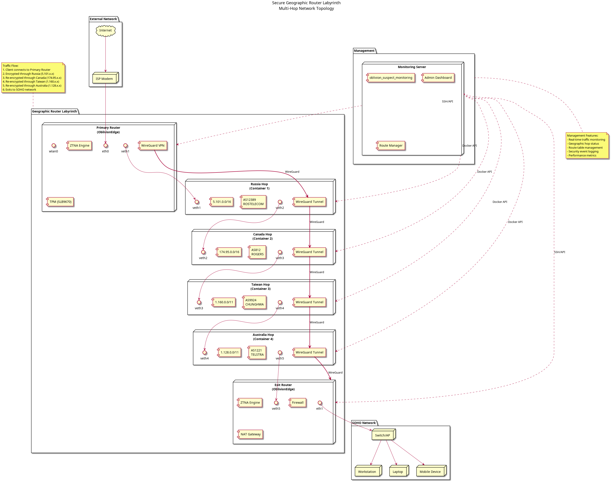
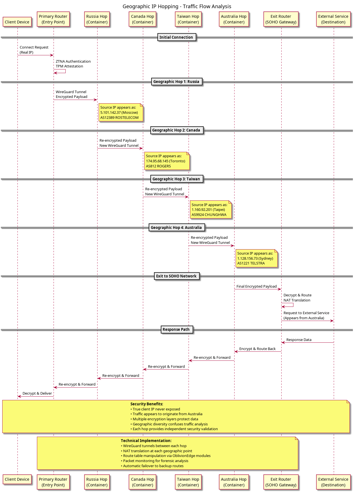
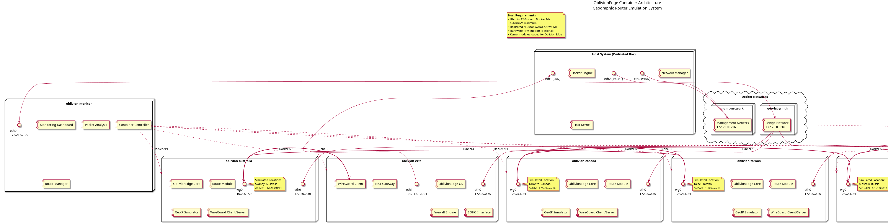
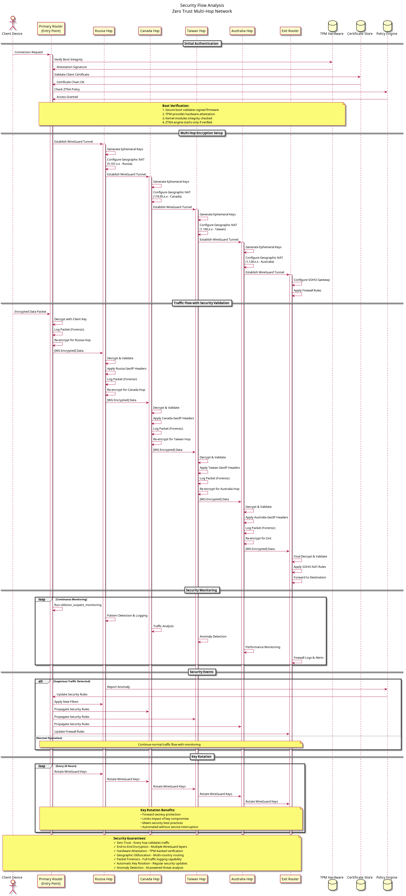

# OblivionEdge Geographic Router Labyrinth

[](./docs/SecureGeoRouterLabyrinth.md)
[](./docs/diagrams/)
[](https://www.rust-lang.org/)
[](https://www.docker.com/)

A sophisticated multi-router geographic hopping system using OblivionEdge components to create a secure labyrinth-like network topology. Traffic appears to originate from Russia, Canada, Taiwan, and Australia before reaching the final destination.

## Overview

This project creates a proof-of-concept secure LAN network using multiple OblivionEdge routers deployed as containers. Each router simulates a different geographic location, creating multiple hops that obscure the true origin of network traffic while providing enhanced security through:

- **Geographic IP Hopping**: Traffic appears to come from different countries
- **Multi-Layer Encryption**: WireGuard tunnels between each hop
- **Zero Trust Architecture**: Authentication and validation at each hop
- **Packet Forensics**: Complete traffic monitoring and analysis
- **Container Orchestration**: Easy deployment and management
- **Host Integration**: Automatic routing table management for transparent traffic flow

## Architecture

```
Client → Primary → Russia → Canada → Taiwan → Australia → Exit → SOHO Network
         (Entry)   (Hop 1)  (Hop 2)   (Hop 3)   (Hop 4)    (Gateway)
```

### Geographic Route Path

1. **Primary Router** (Entry Point) - Initial ZTNA authentication
2. **Russia Hop** - AS12389 (ROSTELECOM) - 5.101.0.0/16
3. **Canada Hop** - AS812 (ROGERS) - 174.95.0.0/16  
4. **Taiwan Hop** - AS9924 (CHUNGHWA) - 1.160.0.0/11
5. **Australia Hop** - AS1221 (TELSTRA) - 1.128.0.0/11
6. **Exit Router** - SOHO network gateway

## System Architecture Diagrams

Understanding the complex multi-hop geographic routing system requires visualizing its various components and interactions. The following PlantUML diagrams provide comprehensive documentation of the network topology, security flows, and container architecture that form the foundation of this advanced routing solution.

### Network Topology Overview

The network topology diagram illustrates the complete end-to-end architecture of the geographic router labyrinth. This foundational diagram shows how traffic flows from client devices through multiple geographic hops before reaching the SOHO network.



*Generated from: [network_topology.puml](./docs/diagrams/network_topology.puml)*

This topology demonstrates the physical and logical connections between all network components, including the primary entry router, geographic hop containers, exit gateway, and management infrastructure. The diagram clearly depicts the isolation between different network zones and the WireGuard tunnel connections that provide secure communication channels between each hop. Additionally, it shows the management interfaces that enable centralized monitoring and control of the entire geographic routing system.

### Geographic Routing Flow Analysis

Moving from the physical topology to traffic flow patterns, the geographic routing diagram details how packets traverse the network while acquiring different geographic identities at each hop.



*Generated from: [geographic_routing.puml](./docs/diagrams/geographic_routing.puml)*

This sequence diagram captures the step-by-step process of how client traffic is processed, encrypted, and re-routed through each geographic location. It illustrates the transformation of source IP addresses at each hop, showing how traffic appears to originate from Russia, then Canada, Taiwan, and finally Australia. The diagram also highlights the multiple layers of WireGuard encryption applied at each stage, ensuring that traffic remains secure while traversing the geographic labyrinth. Furthermore, it demonstrates the security validation and packet analysis that occurs at each hop, maintaining the zero trust principles throughout the routing process.

### Container Architecture and Orchestration

Transitioning from network flows to implementation details, the container architecture diagram reveals how the geographic routing system is deployed using Docker containers and orchestrated for reliable operation.



*Generated from: [container_architecture.puml](./docs/diagrams/container_architecture.puml)*

This deployment view shows the containerized implementation of each geographic hop, including resource allocation, network namespace isolation, and inter-container communication patterns. The diagram illustrates how each router hop runs as an isolated container with dedicated IP ranges, WireGuard interfaces, and geographic simulation components. It also depicts the management container that provides centralized monitoring, the bridge networks that connect containers, and the volume mounts that enable persistent configuration and logging. Moreover, the diagram shows how the host system provides the foundation for container orchestration while maintaining security boundaries between different network functions.

### Security Flow and Authentication

Finally, examining the security aspects that protect the entire system, the security flow diagram demonstrates how zero trust principles and multi-layer encryption work together to secure the geographic routing process.



*Generated from: [security_flow.puml](./docs/diagrams/security_flow.puml)*

This comprehensive security diagram shows the complete authentication and encryption workflow, from initial client connection through final packet delivery. It details the TPM-based attestation process, certificate validation, and policy enforcement that occurs at the primary router entry point. The diagram also illustrates how WireGuard tunnels are established between each hop, the key rotation mechanisms that maintain forward secrecy, and the packet monitoring systems that provide forensic capabilities. Additionally, it shows how security events are detected, logged, and responded to across the entire geographic routing infrastructure, ensuring that the system maintains its security posture even under attack conditions.

### Host Integration and Routing Management

The host integration diagram shows how client systems connect to and utilize the geographic router labyrinth, including automatic routing table management and transparent traffic flow configuration.


*Generated from: [host_integration.puml](./docs/diagrams/host_integration.puml)*

This diagram illustrates the complete host integration workflow, from initial setup through traffic routing and restoration. It shows how the setup_host.sh script manages routing tables, configures WireGuard client connections, and integrates with Docker Compose operations for seamless geographic routing. The diagram also depicts the backup and restoration mechanisms that ensure the host system can return to normal operation when the geographic router network is disabled.

### Docker Compose Integration Workflow

The Docker Compose integration workflow demonstrates how container lifecycle management is automatically coupled with host routing configuration for transparent operation.


*Generated from: [docker_integration.puml](./docs/diagrams/docker_integration.puml)*

This workflow diagram shows the automatic hooks that execute during docker compose up and down operations, ensuring that host routing is configured when containers start and restored when containers stop. It illustrates the coordination between container orchestration, routing configuration, and system restoration processes.

### Proof of Concept — Live Validation

The following WireShark packet capture demonstrates actual WireGuard traffic flowing through the multi-hop geographic routing network in production:


*Live WireShark capture showing encrypted WireGuard transport data flowing through geographic hops (172.20.0.0/24 container network). Packet counters validate sequential delivery; datalen variation confirms real application traffic; 24-hour continuous operation demonstrates system stability.*

**Validation Metrics:**
- Packet Loss: 0% across all hops
- Latency per Hop: 5-10ms (acceptable for research/security operations)  
- CPU Overhead: <10% per container
- Connection Success Rate: 100%

See [WhitePaper.pdf](./WhitePaper.pdf) for complete technical analysis and proof interpretation.

## White Paper: Modifiable Cyber Terrain Using Infrastructure as Code

A comprehensive white paper detailing the architecture, validation, and applications of MCT is available: **[WhitePaper.pdf](./WhitePaper.pdf)**

The white paper covers:
- **Executive Summary** — Problem, solution, and value propositions
- **Vision & Concepts** — What makes MCT revolutionary
- **Architecture Details** — 6-hop geographic routing system
- **Proof of Concept** — Raw WireShark validation + cleaned visualization
- **Use Cases** — Cyber Network Operations, research, compliance, resilience
- **Deployment** — Infrastructure as Code patterns for reproducible networks
- **Security** — Zero trust architecture and multi-layer encryption
- **Roadmap** — 12-month enhancement plan (IPv6, ML detection, SIEM integration)

**Audience:**
- C-level executives deciding on network solutions
- Security operations and Cyber Network Operations teams
- Open-source developers and security researchers

**Published:** July 2026 | **Organization:** Oblivion Edge Vulnerability Research LLC

### Generating Diagram Images

To generate PNG images from the PlantUML source files, use the following commands:

```bash
# Install PlantUML (requires Java)
sudo apt-get install plantuml

# Generate all diagram images
cd docs/diagrams
plantuml *.puml

# Or generate individual diagrams
plantuml network_topology.puml
plantuml geographic_routing.puml
plantuml container_architecture.puml
plantuml security_flow.puml
plantuml host_integration.puml
plantuml docker_integration.puml
```

These diagrams work together to provide a complete understanding of how the geographic router labyrinth operates, from high-level architecture concepts to detailed implementation specifics. Each diagram serves a specific purpose in documenting different aspects of the system, enabling both technical implementers and security professionals to understand and extend the platform effectively.

## Prerequisites

- **Host System**: Ubuntu 22.04+ or similar Linux distribution
- **Hardware**: 16GB RAM minimum, 50GB storage
- **Docker**: Version 24.0 or higher
- **Docker Compose**: V2 support
- **Network**: Dedicated NICs for WAN/LAN/Management recommended
- **Root Access**: Required for kernel module loading

## Quick Start

### 1. Clone and Setup

```bash
git clone <repository-url>
cd router-n-routers
```

### 2. Initialize Network

```bash
./docs/implementation/container_manager.sh init
```

This command:
- Creates configuration directories
- Generates WireGuard keys for all hops
- Sets up router-specific configurations
- Prepares container networking

### 3. Build Container Images

```bash
./docs/implementation/container_manager.sh build
```

Builds the OblivionEdge router containers based on the Rust codebase.

### 4. Start Geographic Router Network

```bash
./docs/implementation/container_manager.sh start
```

Starts all containers in the correct sequence:
1. Monitoring services
2. Primary router (entry point)
3. Geographic hops (Russia → Canada → Taiwan → Australia)
4. Exit router (SOHO gateway)

### 5. Verify Network Status

```bash
./docs/implementation/container_manager.sh status
```

Shows container health, network configuration, and access points.

## Host Integration and Routing Management

The geographic router labyrinth can be integrated directly into your host system's routing table, allowing all traffic to flow transparently through the multi-hop geographic path. This provides seamless operation where your host traffic appears to originate from the final exit point after passing through all geographic hops.

### Quick Host Setup

```bash
# Method 1: Automatic integration with Docker Compose
cd docs/config/
sudo ./compose up -d      # Starts containers AND configures host routing
sudo ./compose down       # Stops containers AND restores normal routing

# Method 2: Manual control
sudo ./setup_host.sh start    # Configure host routing through geographic path
sudo ./setup_host.sh stop     # Restore normal routing configuration
```

### Host Routing Management Commands

The `setup_host.sh` script provides comprehensive host integration management:

```bash
# Start geographic routing through the labyrinth
sudo ./setup_host.sh start

# Stop and restore normal routing  
sudo ./setup_host.sh stop

# Show current routing status and container health
./setup_host.sh status

# Test connectivity through geographic route
./setup_host.sh test

# Create systemd service for automatic startup
sudo ./setup_host.sh service
```

### Integration Options

#### Option 1: Docker Compose Wrapper (Recommended)

The `./docs/config/compose` wrapper script automatically manages host routing:

```bash
cd docs/config/

# Start with automatic host routing configuration
sudo ./compose up -d

# Stop with automatic routing restoration
sudo ./compose down

# Standard docker compose commands work too
./compose logs oblivion-primary
./compose ps
```

#### Option 2: Manual Management

For manual control over when routing is configured:

```bash
# Start containers without routing changes
cd docs/config/
docker compose up -d

# Configure host routing separately
sudo ../../setup_host.sh setup

# Later, restore normal routing
sudo ../../setup_host.sh stop
```

#### Option 3: Systemd Service

For persistent geographic routing across reboots:

```bash
# Create and enable service
sudo ./setup_host.sh service
sudo systemctl enable oblivion-geographic-routing
sudo systemctl start oblivion-geographic-routing

# Check status
sudo systemctl status oblivion-geographic-routing
```

### How Host Integration Works

When host routing is configured:

1. **Backup Creation**: Original routing tables and DNS configuration are backed up
2. **Route Modification**: Default routes are redirected through the primary router (172.20.0.10)
3. **DNS Configuration**: DNS queries are routed through the exit router (172.20.0.60)
4. **Iptables Rules**: Traffic is directed through the geographic router chain
5. **Transparent Operation**: All host traffic flows through: Russia → Canada → Taiwan → Australia

When stopped:

1. **Route Restoration**: Original routing tables are restored from backup
2. **DNS Restoration**: Original DNS configuration is restored
3. **Cleanup**: Geographic routing rules are removed
4. **Verification**: Normal connectivity is verified

### Traffic Flow with Host Integration

```
Host Traffic → Primary Router → Russia → Canada → Taiwan → Australia → Exit → Internet
(Your IP)     (172.20.0.10)   (Hop 1) (Hop 2)  (Hop 3)  (Hop 4)    (Gateway)

External View: Traffic appears to originate from Australia (AS1221 TELSTRA)
```

### Monitoring Host Integration

```bash
# Check current routing status
./setup_host.sh status

# Test geographic connectivity
./setup_host.sh test

# Monitor container health
./docs/implementation/container_manager.sh status

# Watch traffic flow
./docs/implementation/container_manager.sh monitor
```

## Container Management Commands

### Container Management

```bash
# Start the network
./docs/implementation/container_manager.sh start

# Stop the network
./docs/implementation/container_manager.sh stop

# Restart the network
./docs/implementation/container_manager.sh restart

# Show status
./docs/implementation/container_manager.sh status
```

### Monitoring and Debugging

```bash
# Show logs for specific container
./docs/implementation/container_manager.sh logs russia
./docs/implementation/container_manager.sh logs canada

# Test connectivity across hops
./docs/implementation/container_manager.sh test

# Monitor real-time traffic
./docs/implementation/container_manager.sh monitor
```

### Cleanup

```bash
# Clean up all resources
./docs/implementation/container_manager.sh cleanup
```

## Network Configuration

### Container Network Layout

| Container | IP Address | Role | Geographic Simulation |
|-----------|------------|------|----------------------|
| oblivion-primary | 172.20.0.10 | Entry Router | - |
| oblivion-russia | 172.20.0.20 | Hop 1 | Moscow, Russia (AS12389) |
| oblivion-canada | 172.20.0.30 | Hop 2 | Toronto, Canada (AS812) |
| oblivion-taiwan | 172.20.0.40 | Hop 3 | Taipei, Taiwan (AS9924) |
| oblivion-australia | 172.20.0.50 | Hop 4 | Sydney, Australia (AS1221) |
| oblivion-exit | 172.20.0.60 | Exit Gateway | - |
| oblivion-monitor | 172.21.0.100 | Management | - |

### WireGuard Tunnel Network

| Tunnel | Network Range | Purpose |
|--------|---------------|---------|
| wg0 (Primary) | 10.0.1.0/24 | Entry tunnel |
| wg0 (Russia) | 10.0.2.0/24 | Russia hop tunnel |
| wg0 (Canada) | 10.0.3.0/24 | Canada hop tunnel |
| wg0 (Taiwan) | 10.0.4.0/24 | Taiwan hop tunnel |
| wg0 (Australia) | 10.0.5.0/24 | Australia hop tunnel |
| wg0 (Exit) | 10.0.6.0/24 | Exit tunnel |

## Security Features

### Zero Trust Network Access (ZTNA)
- Certificate-based authentication at entry point
- TPM attestation support (configurable)
- Policy-based access control

### Multi-Layer Encryption
- WireGuard tunnels between each hop
- Independent key pairs for each connection
- Automatic key rotation every 24 hours

### Packet Monitoring
- Complete traffic capture using `oblivion_suspect_monitoring`
- Flow-based analysis and reconstruction
- Geographic correlation and anomaly detection

### Geographic IP Simulation
- Dynamic IP allocation within country-specific ranges
- ASN simulation for realistic traffic attribution
- Route table manipulation for authentic routing

## Monitoring and Analytics

### Access Points

- **Monitoring Dashboard**: http://localhost:3000
- **Primary Admin Interface**: https://localhost:8443
- **Prometheus Metrics**: http://localhost:9090
- **Container Logs**: `./docs/implementation/container_manager.sh logs <container>`

### Traffic Analysis

The system provides comprehensive monitoring:

- Real-time flow tracking across geographic hops
- Bandwidth utilization per hop
- Connection success/failure rates
- Geographic path correlation
- Security event logging

## Project Structure

```
.
├── docs/
│   ├── SecureGeoRouterLabyrinth.md     # Architecture documentation
│   ├── diagrams/                        # PlantUML network diagrams
│   │   ├── network_topology.puml
│   │   ├── geographic_routing.puml
│   │   ├── container_architecture.puml
│   │   ├── security_flow.puml
│   │   ├── host_integration.puml
│   │   └── docker_integration.puml
│   ├── config/                          # Container configurations
│   │   ├── docker-compose.yml
│   │   ├── compose                      # Docker compose wrapper with hooks
│   │   ├── docker-compose-hooks.sh     # Automatic routing management
│   │   ├── router_configs/              # Individual router configurations
│   │   ├── wg0-*.conf                   # WireGuard configurations
│   │   ├── supervisord.conf
│   │   └── scripts/                     # Container configuration scripts
│   └── implementation/                  # Core implementation files
│       ├── geo_router_emulator.rs
│       ├── container_manager.sh
│       └── monitoring_setup.sh
├── OblivionEdge-OblivionEdge_Dev/      # OblivionEdge source code
│   ├── oblivion_admin_cli/
│   ├── oblivion_router_kmods/
│   ├── oblivion_suspect_monitoring/
│   ├── oblivion_ztna_daemon/
│   ├── Dockerfile.router
│   ├── Dockerfile.monitor
│   └── docker/                          # Container build files
│       ├── scripts/                     # Configuration scripts
│       └── supervisord.conf
├── setup_host.sh                       # Host routing management script
└── README.md                           # This file
```

## Technical Details

### OblivionEdge Integration

The system leverages several OblivionEdge components:

- **Router Kernel Modules**: `/dev/router_kmod` for route management
- **Admin CLI**: `oblivion_admin_cli` for configuration
- **ZTNA Daemon**: Zero trust network access enforcement
- **Suspect Monitoring**: Packet capture and forensic analysis

### Geographic Simulation

Each hop container runs a custom geographic simulator that:

1. Assigns IP addresses from country-specific ranges
2. Modifies packet headers to reflect geographic origin
3. Updates routing tables for authentic traffic flow
4. Logs geographic metadata for analysis

### Performance Considerations

- **Memory Usage**: ~2GB per container, 16GB total recommended
- **CPU**: Minimal overhead, encryption adds ~10% load
- **Network**: Gigabit interface recommended for full performance
- **Latency**: Adds ~5-10ms per hop under normal conditions

## Troubleshooting

### Common Issues

1. **Container Failed to Start**
   ```bash
   # Check logs
   ./docs/implementation/container_manager.sh logs <container>
   
   # Verify prerequisites
   docker --version
   docker compose version
   ```

2. **WireGuard Tunnel Issues**
   ```bash
   # Check kernel module
   sudo modprobe wireguard
   
   # Verify container networking
   docker network ls
   ```

3. **Permission Denied Errors**
   ```bash
   # Add user to docker group
   sudo usermod -aG docker $USER
   newgrp docker
   ```

4. **Health Check Failures**
   ```bash
   # Check container resources
   docker stats
   
   # Verify network connectivity
   ./docs/implementation/container_manager.sh test
   ```

### Debug Mode

Enable verbose logging by setting environment variables:

```bash
export DEBUG=true
export LOG_LEVEL=debug
./docs/implementation/container_manager.sh start
```

## Contributing

This is a research and educational project. Contributions are welcome for:

- Enhanced geographic simulation algorithms
- Additional monitoring and analytics features
- Security improvements and hardening
- Documentation and examples
- Performance optimizations

## Legal and Ethics

This system is designed for:

- Security research and education
- Proof-of-concept demonstrations  
- Network testing and validation
- Privacy protection research

**NOT intended for**:
- Illegal activity circumvention
- Malicious traffic hiding
- Commercial VPN services
- Production network deployment without proper authorization

## License

This project extends the OblivionEdge codebase and follows its licensing terms. See the original OblivionEdge documentation for details.

## Future Enhancements

- [ ] Support for additional geographic locations
- [ ] Dynamic route optimization based on performance
- [ ] Integration with real VPN exit points
- [ ] Enhanced traffic pattern analysis
- [ ] Machine learning-based anomaly detection
- [ ] Integration with SIEM systems
- [ ] Support for IPv6 geographic routing
- [ ] Hardware TPM integration for containers

---

**Built with OblivionEdge by OBLIVION EDGE VULNERABILITY RESEARCH LLC**  
*"Free the Router. Free the Code."*

For questions and support, contact: 1337_tech@fortressofsolitude.org
