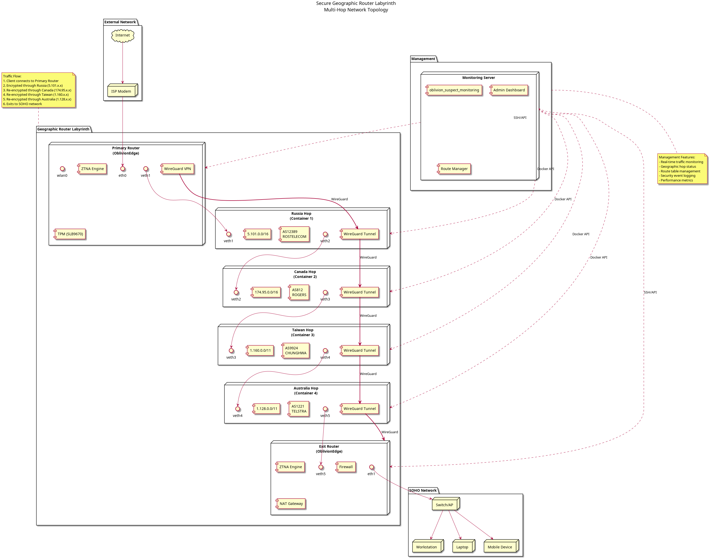
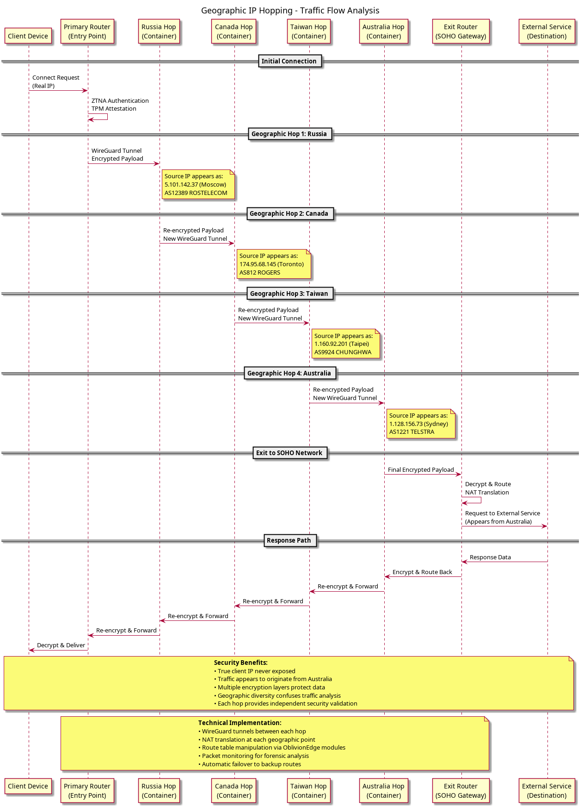
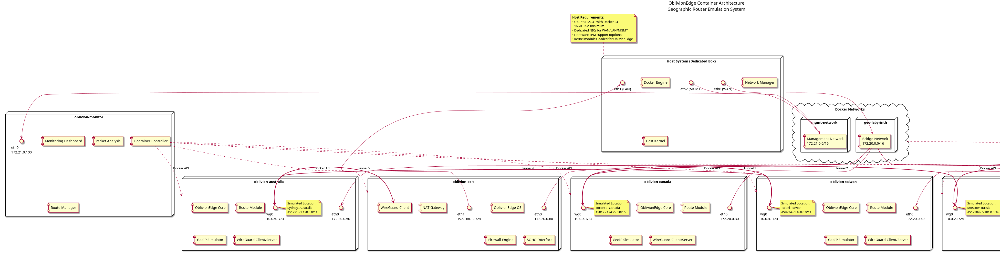
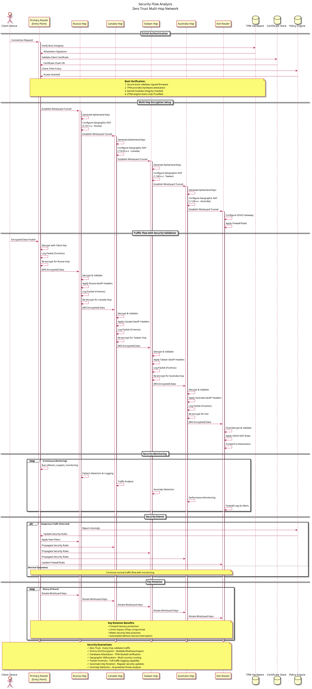

# Modifiable Cyber Terrain — System Architecture Overview

## High-Level Network Topology

*Complete end-to-end architecture showing traffic flow from client through geographic hops to external network.*

## Container Network Specification

| Container | IP Address | Role | Docker Network | Connected To |
|-----------|-----------|------|---|---|
| oblivion-primary | 172.20.0.10 | Entry Point | geolabyrinth | Russia (via WireGuard) |
| oblivion-russia | 172.20.0.20 | Hop 1 | geolabyrinth | Primary, Canada |
| oblivion-canada | 172.20.0.30 | Hop 2 | geolabyrinth | Russia, Taiwan |
| oblivion-taiwan | 172.20.0.40 | Hop 3 | geolabyrinth | Canada, Australia |
| oblivion-australia | 172.20.0.50 | Hop 4 | geolabyrinth | Taiwan, Exit |
| oblivion-exit | 172.20.0.60 | Gateway | geolabyrinth | Australia, Internet |
| oblivion-monitor | 172.21.0.100 | Management | monitoring | All containers |

## WireGuard Tunnel Topology

| Tunnel | Network | Connects | Encryption | Key Rotation |
|--------|---------|----------|-----------|---|
| wg0-primary | 10.0.1.0/24 | Client → Primary | AES-256 | 24h |
| wg0-hop1 | 10.0.2.0/24 | Primary → Russia | ChaCha20 | 24h |
| wg0-hop2 | 10.0.3.0/24 | Russia → Canada | ChaCha20 | 24h |
| wg0-hop3 | 10.0.4.0/24 | Canada → Taiwan | ChaCha20 | 24h |
| wg0-hop4 | 10.0.5.0/24 | Taiwan → Australia | ChaCha20 | 24h |
| wg0-exit | 10.0.6.0/24 | Australia → Exit | ChaCha20 | 24h |

## Geographic Routing Flow

*Sequence diagram showing how packets flow through each geographic hop with transformations at each stage.*

## Container Architecture and Deployment

*Containerized implementation showing resource allocation, network namespaces, and inter-container communication.*

*Complete deployment view with host system integration and Docker Compose orchestration.*

## Security and Zero Trust Flow

*Security architecture showing authentication, encryption, and policy enforcement at each layer.*

*Complete zero trust implementation demonstrating continuous verification at every hop.*

## Host Integration

*Host system integration workflow showing automatic routing table management and traffic flow configuration.*

## Docker Compose Integration

*Container lifecycle management coupled with host routing configuration for seamless operation.*

## Oblivion Edge Architecture

*Full Oblivion Edge router architecture integrated within the geographic labyrinth system.*
